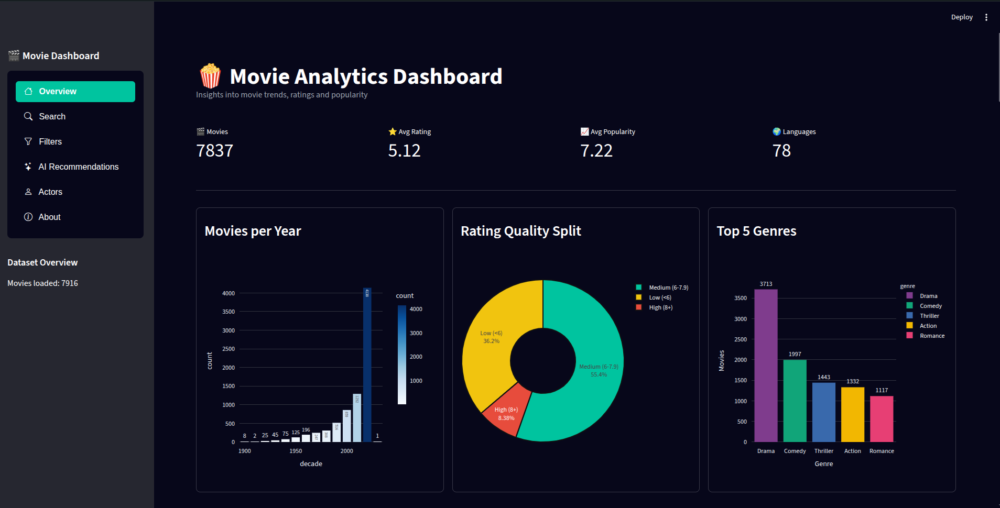
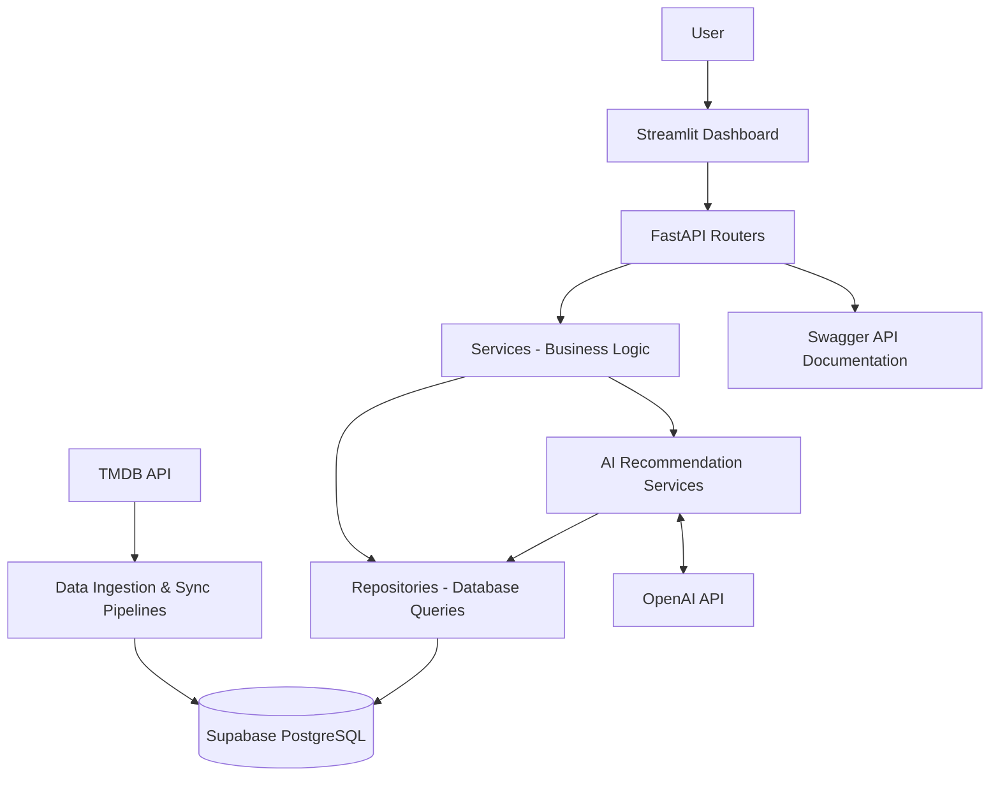
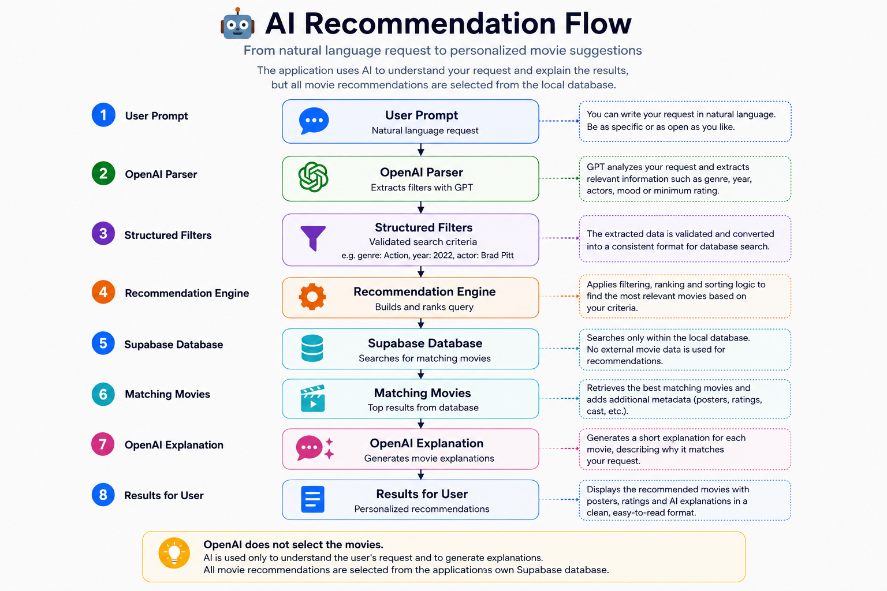
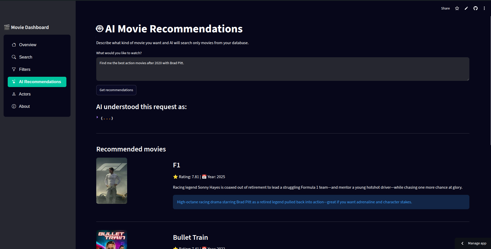
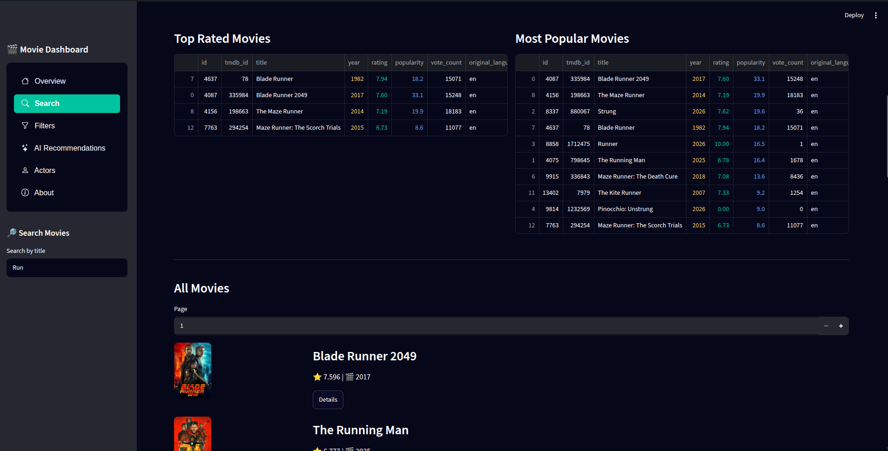
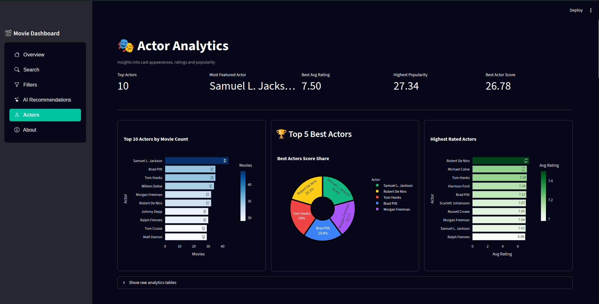
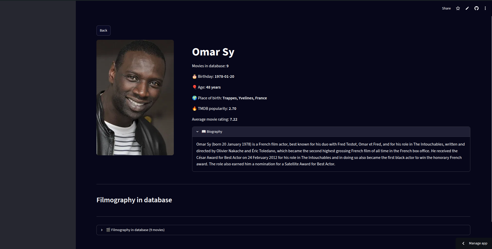
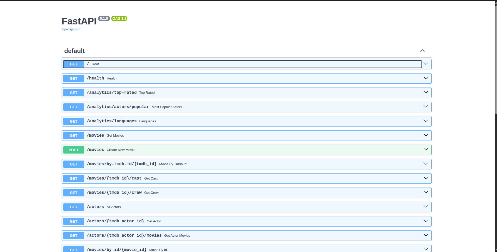

 <div align="center">

# 🎬 Movie Analytics Dashboard

### End-to-end movie analytics and AI recommendation platform

Built with **FastAPI**, **Supabase**, **Streamlit**, **TMDB API** and **OpenAI**


🚀 **Live API:** https://movie-project-fast-api.onrender.com/docs

📂 **GitHub Repository:** https://github.com/ErikBobko/movie_project_fast_api

🖥️ **Live Dashboard:** https://movie-analytics-valasek.streamlit.app/

</div>

---

## Overview

Movie Analytics Dashboard is an end-to-end data application that downloads movie data from the TMDB API, transforms it, stores it in a PostgreSQL database hosted on Supabase, exposes it through a FastAPI backend and presents the results in an interactive Streamlit dashboard.

The application also includes AI-powered movie recommendations. A natural-language request is converted into structured filters, the application searches its own Supabase database, and AI generates a short explanation for each recommendation.

<p align="center">
  
</p>

## ✨ Features

<table>
<tr>
<td width="50%">

### 📊 Analytics Dashboard

- Interactive KPIs
- Movie statistics
- Genre distribution
- Rating analysis
- Popularity metrics

</td>
<td width="50%">

### 🔍 Movie Search

- Search by title
- Pagination support
- Movie details
- Similar movie recommendations
- Optimized database queries

</td>
</tr>
<tr>
<td width="50%">

### 🎭 Actor Analytics

- Top actors by movie count
- Highest-rated actors
- Most popular actors
- Interactive charts
- Actor profiles & filmography

</td>
<td width="50%">

### 🤖 AI Recommendations

- Natural language movie search
- GPT-powered filter extraction
- Database-driven recommendations
- AI-generated explanations
- Personalized movie suggestions

</td>
</tr>
<tr>
<td width="50%">

### ⚡ FastAPI Backend

- REST API
- Interactive Swagger documentation
- Pagination
- Filtering
- Production deployment

</td>
<td width="50%">

### 🗄️ Database

- Supabase PostgreSQL
- Normalized relational schema
- Many-to-many relationships
- TMDB ETL pipeline
- Automatic data synchronization

</td>
</tr>
</table>

## 🏗️ Architecture



The backend follows a layered architecture to separate HTTP handling, business logic, and database access.

- **Routers** handle API requests, input validation, and HTTP responses.
- **Services** implement application business logic and coordinate operations.
- **Repositories** manage database queries and interactions with Supabase PostgreSQL.
- **Pipelines** synchronize movie and actor data from the external TMDB API.

This separation improves code maintainability, readability, and testability.

## 📁 Project Structure

```text
movie_project_fast_api/
│
├── clients/          # External API clients (TMDB, OpenAI)
├── pipelines/        # Data ingestion and synchronization
├── routers/          # FastAPI endpoints and HTTP handling
├── services/         # Business logic
├── repositories/     # Supabase database queries
├── models/           # Pydantic data models
├── tests/
│   ├── api/          # API endpoint tests
│   └── unit/         # Unit tests
├── streamlit_app/    # Streamlit dashboard
├── docs/             # Screenshots and documentation
├── db.py             # Supabase client configuration
├── config.py         # Application configuration
├── main.py           # FastAPI application entry point
└── requirements.txt  # Python dependencies
```

## 🤖 AI Recommendation Flow

The AI recommendation system combines natural language understanding with deterministic database queries.

Instead of allowing AI to generate random movie suggestions, every recommendation comes exclusively from the application's own movie database.

<p align="center">
  
</p>

### Example

**User request**

```text
Find me the best action movies after 2020 with Brad Pitt.
```

<p align="center">
  
</p>

**Extracted filters**

```json
{
  "genre": "Action",
  "year_from": 2020,
  "actor": "Brad Pitt",
  "sort_by": "rating"
}
```

**Recommendation process**

1. OpenAI extracts structured filters from the prompt.
2. The recommendation engine searches the application's Supabase database.
3. Matching movies are ranked according to the selected criteria.
4. OpenAI generates a short explanation for each recommendation.

> **Note:** OpenAI is used to understand the user's request and generate explanations. Movie recommendations are selected from the application's own database.

## 🔎 Search

<p align="center">
  
</p>

## 🎭 Actor Analytics

<p align="center">
  
</p>

<p align="center">
  
</p>

## 🚀 API Endpoints

The FastAPI backend provides REST endpoints for movie data, actor information, analytics, AI recommendations, and data synchronization.

| Method | Endpoint | Description |
|---|---|---|
| GET | `/movies` | Retrieve movies with pagination |
| GET | `/movies/by-tmdb-id/{tmdb_id}` | Retrieve a movie by TMDB ID |
| GET | `/movies/{tmdb_id}/cast` | Retrieve movie cast |
| GET | `/movies/{tmdb_id}/crew` | Retrieve movie crew |
| GET | `/actors` | Retrieve and search actors |
| GET | `/actors/{tmdb_actor_id}` | Retrieve actor details |
| GET | `/actors/{tmdb_actor_id}/movies` | Retrieve an actor's filmography |
| GET | `/analytics/top-rated` | Retrieve highest-rated movies |
| GET | `/analytics/actors/top` | Rank actors by movie count |
| GET | `/analytics/actors/highest-rated` | Rank actors by average movie rating |
| GET | `/analytics/actors/popular` | Rank actors by popularity |
| GET | `/analytics/actors/best` | Retrieve combined actor rankings |
| POST | `/ai/parse` | Convert natural-language requests into filters |
| POST | `/ai/recommendations` | Generate database-backed AI recommendations |
| POST | `/sync/full` | Run the full data synchronization pipeline |

Interactive API documentation is available through FastAPI Swagger UI at `/docs`.

<p align="center">
  
</p>

## 🧪 Testing

The project includes automated tests using **pytest**, **FastAPI TestClient**, and **monkeypatch** to verify API behavior and business logic.

The test suite covers:

- **API endpoints** – successful responses and error handling.
- **Input validation** – invalid parameters and HTTP 422 responses.
- **HTTP status codes** – including 200, 404, and 422.
- **Movie and actor analytics** – business logic, calculations, and sorting.
- **Database isolation** – mocking dependencies to avoid modifying production data.
- **External API failures** – verifying correct behavior when TMDB requests fail.

### Running Tests

Run all tests from the project root:

```bash
python -m pytest -q
```

Latest local test result:

**86 passed, 1 warning**

Tests use mocked dependencies where appropriate to avoid unnecessary external API calls and database operations.

## 🌐 Live Demo

| Service | Link |
|---|---|
| 🎬 Streamlit Dashboard | https://movie-analytics-valasek.streamlit.app/ |
| 🚀 FastAPI Swagger | https://movie-project-fast-api.onrender.com/docs |

## 🛠 Tech Stack

| Category | Technologies |
|---|---|
| Language | Python 3.12 |
| Backend | FastAPI |
| Database | Supabase PostgreSQL |
| Frontend | Streamlit |
| AI | OpenAI GPT |
| Data Source | TMDB API |
| Testing | pytest, FastAPI TestClient |
| Deployment | Render, Streamlit Community Cloud |
| Version Control | Git & GitHub |

## ⚙️ Installation

Clone the repository and install the dependencies:

```bash
git clone https://github.com/ErikBobko/movie_project_fast_api.git
cd movie_project_fast_api
pip install -r requirements.txt
```

Configure the required environment variables for Supabase, TMDB, and OpenAI before starting the application. Local execution requires access to a configured Supabase database.

Start the FastAPI backend:

```bash
uvicorn main:app --reload
```

Start the Streamlit dashboard in a separate terminal:

```bash
streamlit run streamlit_app/app.py
```

Alternatively, explore the application using the live demo links above.

## 🔮 Future Improvements

- User authentication
- Personal watchlists
- Advanced recommendation algorithms
- Docker deployment
- CI/CD pipeline

## 📄 About This Project

This project was created for educational purposes and as part of my Python backend developer portfolio.